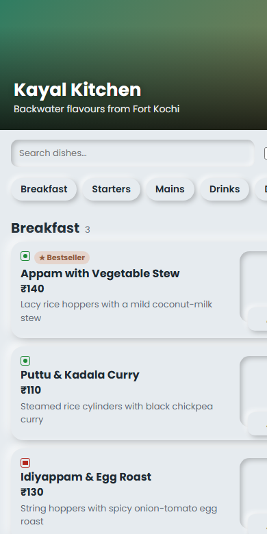

# Photographicode — QR menus and free pages for Kochi cafés

**Live:** https://photographicode.github.io

A small business I run in Kochi: cafés get a QR menu customers can order from, a free web page, and short promo reels.

## What's in this site

- **Homepage** — the offer, a live demo menu, and a WhatsApp sign-up
- **`/kochi/`** — a directory of about 1,470 Kochi cafés and eateries built from OpenStreetMap data
- **`/demo/<café>/`** — 152 personalised pitch pages, one per café I plan to visit. Each runs the real menu app with a browser-only fake API, so you can place an order and watch it appear on a "kitchen screen" in another tab
- **`/field/`** — my phone app for door-to-door visits: status and notes per café, prefilled WhatsApp messages, printable QR cards

## How it's built

Static HTML, CSS and JavaScript on GitHub Pages, generated by Node build scripts from the main menu app (ordering + dashboard). Demo orders use `BroadcastChannel` between tabs, so no server is needed. Built with AI-assisted development (Claude).
